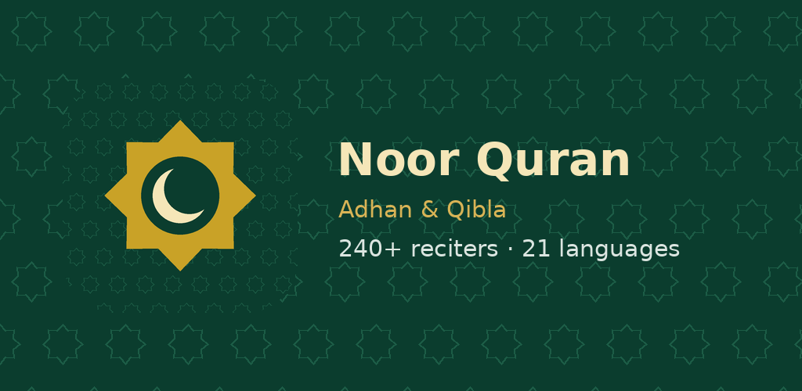

# Noor Quran – Adhan & Qibla

Quran recitations from 240+ reciters, the full Quran text with translations, prayer times with the
adhan, a live-GPS Qibla arrow, adhkar, hadith and tasbih — in 21 languages. No ads, no account, no tracking.

## Download

**[⬇ Latest release](https://github.com/bara-almustafa/noor-quran/releases/latest)**

| Platform | File | Requirement |
|---|---|---|
| Android | `NoorQuran-1.0.0.apk` | Android 10 or newer |
| iPhone | `NoorQuran-1.0.0-unsigned.ipa` | iOS 16 or newer, sideload only |

### Install on Android

1. Download the `.apk` on your phone and open it.
2. If asked, allow your browser or file manager to **install unknown apps**.
3. Open **Noor Quran** and allow location (prayer times & Qibla) and notifications (adhan).

### Install on iPhone (sideload)

The iPhone file is unsigned. Install it with [Sideloadly](https://sideloadly.io) or
[AltStore](https://altstore.io) using your Apple ID, then trust it under
Settings → General → VPN & Device Management (and enable Developer Mode on iOS 16+).
With a free Apple ID it must be re-signed every 7 days.

## Verify your download

Compare the SHA-256 of your file with `SHA256SUMS.txt` in the release.
Android APK signing certificate SHA-256:
`e671e4f439ac00c8b0222e6fae5d9b95add1de4ea7380bb0dd0f6c123aa1ab37`

## Privacy

[Privacy policy](https://bara-almustafa.github.io/noor-privacy/) — location is used only to calculate
prayer times and the Qibla direction.

## Sponsor the project

Noor Quran is free, with no ads and no tracking. If it helps you, you can sponsor its development:

  

☕ **[buymeacoffee.com/0xcybersoldier](https://buymeacoffee.com/0xcybersoldier)**

## Credits

Content from [mp3quran.net](https://www.mp3quran.net), [Al Quran Cloud](https://alquran.cloud),
[QuranEnc](https://quranenc.com), [Hisn al-Muslim](https://www.hisnmuslim.com) and
[Aladhan](https://aladhan.com). Adhan recording by Aaqib Azeez (CC BY-SA 4.0, Wikimedia Commons).
